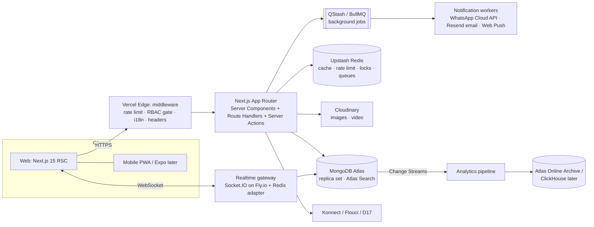

# 1. Complete Architecture

## 1.1 High-level view



## 1.2 Architectural style: modular monolith

There is one Next.js deployment, organized by **domain modules** that never reach into each other's models directly. Each module exposes a service API instead:

```
src/
  app/                    # routes only (thin): pages, layouts, route handlers
  modules/ (future)       # domain logic: booking, catalog, social, chat, billing, ...
  lib/                    # cross-cutting: db, auth, rbac, rate-limit, cloudinary, theme, geo
  models/                 # Mongoose schemas (one file per aggregate)
  components/             # ui/ (design-system primitives), effects/, sections/
  data/                   # demo + reference data (governorates, categories)
```

**Why not microservices on day one?** A team of 2–6 engineers ships about 3× faster in a monolith. The module boundaries below are drawn so that each one can later become its own service:

| Module | Owns collections | Extractable as |
|--------|------------------|----------------|
| Identity | users, accounts, sessions, auditLogs | Auth service |
| Catalog | centers, services, employees, themes | Core API |
| Booking | bookings, bookingLocks, waitlist | Booking service (highest write load) |
| Social | posts, stories, comments, likes, follows | Feed service |
| Chat | conversations, messages | Realtime service (first to extract) |
| Reviews | reviews, centerScores | Core API |
| Loyalty | loyaltyLedger, badges | Core API |
| Billing | plans, subscriptions, invoices, payments | Billing service |
| Analytics | events, dailyStats | Pipeline |

## 1.3 Request lifecycle

1. **Edge middleware** (`src/middleware.ts`) adds security headers and applies a rate limit by IP and route class. It gates `/dashboard` and `/admin` on the JWT role, and negotiates the locale.
2. **Server Components** read data through cached repositories (`unstable_cache` / `"use cache"` with tag invalidation such as `center:{slug}`).
3. **Mutations** go through Server Actions or Route Handlers, in this order: zod validation → `authorize(session, permission, resource)` → service → audit log → `revalidateTag`.
4. **Side effects** (notifications, score recomputation, analytics) are pushed to a queue and never run inline.

## 1.4 Scalability targets & how we hit them

| Target | Strategy |
|--------|----------|
| 100k+ users | Stateless JWT sessions; the user doc is read only on profile pages |
| 10k+ centers | Discovery pages are statically generated + ISR (`revalidate: 300`) and tag-invalidated on edit. Atlas Search runs geo + text queries |
| Millions of bookings | `bookings` is sharded on `{ centerId: "hashed" }` when it reaches about 50M documents. TTL archival of bookings older than 24 months to Online Archive. Compound indexes are sized for the owner calendar query |
| Hot slots (Eid, weddings season) | Granule locks (see booking engine) + a Redis pre-check. Conflicts resolve in O(1) |
| Read amplification | Center cards are denormalized (`ratingAvg`, `reviewCount`, `priceFrom`, `coverUrl`) onto the center doc and maintained by events |

## 1.5 Environments

| Env | Branch | DB | Notes |
|-----|--------|----|-------|
| local | any | Docker Mongo or Atlas free tier; demo fallback when there is no `MONGODB_URI` | `npm run dev` |
| preview | PR | Atlas `hajemti-preview` | Vercel preview URL per PR |
| staging | `develop` | Atlas M10 `staging` | seeded with anonymized data |
| production | `main` | Atlas M30+ (eu-west / Paris region, closest to Tunis) | |

## 1.6 Key technology decisions

| Decision | Choice | Rationale |
|----------|--------|-----------|
| Auth | Auth.js (NextAuth v5) with JWT strategy | Google/Facebook/Apple out of the box; edge-compatible session checks |
| DB | MongoDB Atlas + Mongoose | Flexible theme/page documents; native geo; Atlas Search avoids running Elastic |
| Search | Atlas Search (`$search` with `geoWithin` + `text` + fuzzy) | Handles French and Arabic analyzers and typo tolerance ("coifure" → "coiffure") |
| Realtime | Socket.IO gateway on Fly.io (Paris), Redis adapter | Vercel functions can't hold websockets; Ably is a managed fallback |
| Jobs | Upstash QStash (serverless) → BullMQ once workers exist | Zero-ops start |
| Media | Cloudinary | On-the-fly transforms, video, moderation add-ons |
| Payments | Konnect (cards + e-DINAR + wallet), Flouci, D17 | Tunisian rails; Stripe isn't available to Tunisian merchants |
| WhatsApp | Meta WhatsApp Cloud API | Tunisians answer WhatsApp messages far more than email |
