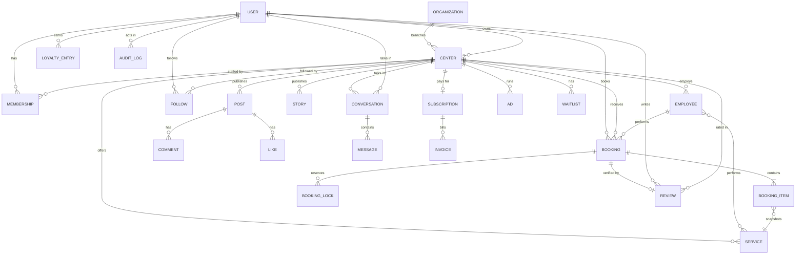

# 2. MongoDB Database Design

## Conventions

- **Money**: integer **millimes** (1 TND = 1000 millimes). A field such as `priceMillimes: 45000` means 45.000 DT. There are never any floats.
- **Time**: UTC `Date` in the database. All rendering and slot math happens in `Africa/Tunis`. Working hours are stored as minutes from local midnight.
- **i18n text**: `{ fr: string, ar?: string, en?: string }` (type `LocalizedString`).
- **Soft delete**: `deletedAt` plus a partial index filter `{ deletedAt: null }`.
- **Denormalization** is allowed for read-heavy cards. Every denormalized field has exactly one writer (an event handler).
- Every collection has `createdAt` and `updatedAt` (`timestamps: true`).

## Collections

### users
| Field | Type | Notes |
|-------|------|-------|
| `_id` | ObjectId | |
| `email` | string | unique, sparse, lowercase |
| `phone` | string | E.164 `+216XXXXXXXX`, unique, sparse |
| `name`, `avatarUrl`, `bio` | string | |
| `role` | enum | `SUPER_ADMIN \| OWNER \| MANAGER \| EMPLOYEE \| CUSTOMER` (global role) |
| `memberships` | `[{ centerId, role: OWNER\|MANAGER\|EMPLOYEE, employeeId? }]` | per-center roles (multi-branch) |
| `providers` | `[{ provider, providerAccountId }]` | OAuth links |
| `passwordHash` | string? | argon2id; only for credentials login |
| `locale` | `fr\|ar\|en` | |
| `loyalty` | `{ points, tier: BRONZE\|SILVER\|GOLD\|VIP, lifetimePoints }` | |
| `favorites` | ObjectId[] → centers | capped at 500 |
| `notificationPrefs` | `{ whatsapp, email, push, marketing }` | |
| `status` | `active\|suspended\|deleted` | |
| `lastLoginAt` | Date | |

Indexes: `{email:1}` unique sparse · `{phone:1}` unique sparse · `{"memberships.centerId":1}` · `{"providers.provider":1,"providers.providerAccountId":1}` unique sparse

### centers (aggregate root of a business)
| Field | Type | Notes |
|-------|------|-------|
| `slug` | string | unique, used in `/center/:slug` and as the subdomain |
| `name`, `description` | LocalizedString | |
| `categories` | enum[] | `beauty_center, hair_salon, women_salon, barbershop, nail_studio, makeup_artist, spa, hammam, wellness, laser, aesthetic_clinic, freelancer` |
| `ownerId` | ObjectId → users | |
| `organizationId` | ObjectId? | Enterprise: groups branches |
| `address` | `{ line1, governorate, delegation, city, postalCode }` | governorate = slug from `src/data/tunisia.ts` |
| `location` | GeoJSON Point `[lng, lat]` | **2dsphere** |
| `contact` | `{ phone, whatsapp, email, website, instagram, facebook, tiktok }` | |
| `openingHours` | `[{ day 0-6, open: min, close: min, breaks: [{start,end}] }]` | |
| `specialDays` | `[{ date, closed, open?, close? }]` | holidays and Ramadan hours |
| `media` | `{ logo, cover, gallery: [{publicId, type, w, h, alt}], heroVideo? }` | Cloudinary public IDs |
| `theme` | embedded Theme document (see the theme builder doc) | the published version |
| `themeDraft` | Theme | the unpublished draft |
| `plan` | `FREE\|PRO\|PREMIUM\|ENTERPRISE` | denormalized from subscription |
| `stats` | `{ ratingAvg, reviewCount, bookingCount, followerCount, score, responseRate, completionRate }` | denormalized |
| `priceFromMillimes` | int | min of active services |
| `amenities` | string[] | wifi, parking, women_only, kids, accessible... |
| `genderFocus` | `women\|men\|unisex` | essential filter in the Tunisian market |
| `verified` | boolean | KYC: RNE / patente checked |
| `status` | `draft\|pending_review\|published\|suspended` | |
| `customDomain` | string? | Premium: `beautylounge.tn` |
| `bookingSettings` | `{ slotStepMin:15, minNoticeMin:60, maxAdvanceDays:60, cancellationWindowMin:240, autoConfirm:true, depositPercent:0 }` | |

Indexes: `{slug:1}` unique · `{location:"2dsphere"}` · `{"address.governorate":1,"categories":1,"stats.score":-1}` · `{status:1,plan:-1,"stats.score":-1}` · `{customDomain:1}` unique sparse · Atlas Search index `centers_search` on name.fr/ar, description, categories, address.*, location (geo).

### services
`centerId`, `categoryKey`, `name: LocalizedString`, `description`, `durationMin`, `bufferAfterMin`, `priceMillimes`, `priceMaxMillimes?` (for "from X to Y" pricing), `gender`, `employeeIds[]` (who can perform it), `imagePublicId`, `isActive`, `sortOrder`, `bookingCount`, `variants?: [{name, durationMin, priceMillimes}]`.
Indexes: `{centerId:1,isActive:1,sortOrder:1}` · `{categoryKey:1,priceMillimes:1}`.

### employees
`centerId`, `userId?` (when the employee has a login), `displayName`, `title`, `avatarPublicId`, `bio`, `serviceIds[]`, `workingHours` (same shape as openingHours), `timeOff: [{start, end, reason}]`, `color` (calendar), `isBookable`, `ratingAvg`, `commissionPercent?`.
Index: `{centerId:1,isBookable:1}`.

### bookings
| Field | Notes |
|-------|-------|
| `ref` | human-readable `HJ-7K3P9Q`, unique |
| `centerId`, `customerId`, `employeeId` | |
| `items` | `[{ serviceId, name, durationMin, priceMillimes }]` (a snapshot, so later price edits don't rewrite history) |
| `start`, `end` | UTC |
| `status` | `pending → confirmed → checked_in → completed` · `cancelled_by_customer` · `cancelled_by_center` · `no_show` |
| `source` | `web\|app\|whatsapp\|walk_in\|owner_dashboard` |
| `totalMillimes`, `depositMillimes`, `paymentStatus` | `unpaid\|deposit_paid\|paid\|refunded` |
| `notes`, `customerSnapshot {name, phone}` | walk-ins have no account |
| `history` | `[{at, by, from, to, reason}]` (state transitions) |
| `reminderSentAt`, `reviewRequestedAt` | |

Indexes: `{ref:1}` unique · `{centerId:1,start:1}` (calendar) · `{employeeId:1,start:1}` · `{customerId:1,start:-1}` (history) · `{status:1,start:1}` (reminder job).
Shard key once needed: `{centerId:"hashed"}`.

### bookingLocks (double-booking prevention)
`_id: "{employeeId}:{granuleStartISO}"`, `bookingId`, `expiresAt` (TTL for holds). See [04-booking-engine.md](04-booking-engine.md).

### waitlist
`centerId`, `serviceId`, `employeeId?`, `customerId`, `date`, `windowStart`, `windowEnd`, `status: waiting|notified|booked|expired`. TTL on `date + 1d`.

### reviews
`centerId`, `bookingId` (**unique**: one review per booking, which enforces verified reviews), `customerId`, `employeeId?`, `rating 1-5`, `subRatings {quality, cleanliness, welcome, value, punctuality}`, `comment`, `photos[]`, `reply {text, at, by}`, `status: visible|flagged|hidden`, `helpfulCount`.
Indexes: `{centerId:1,status:1,createdAt:-1}` · `{bookingId:1}` unique.

### conversations / messages
See [05-chat.md](05-chat.md). `conversations {centerId, customerId, lastMessage{...}, unread{customer, center}, bookingId?}`. Unique `{centerId, customerId}`.
`messages {conversationId, senderId, senderRole, type: text|image|voice|file|booking_ref|system, body, media{publicId, durationSec?, bytes}, bookingId?, readAt}`. Index `{conversationId:1, _id:-1}`.

### posts / comments / likes / follows / stories
- `posts {centerId, authorId, type: post|promotion|event|announcement|video, body: LocalizedString, media[], promo?{serviceIds, discountPercent, validFrom, validTo, code}, event?{startsAt, location}, stats{likes, comments, shares}, visibility}`. Index `{centerId:1, createdAt:-1}`.
- `stories {centerId, media, expiresAt}` with a TTL index on `expiresAt`, so stories vanish after 24h.
- `comments {postId, userId, body, parentId?}`
- `likes {_id: "{postId}:{userId}"}`, idempotent by construction.
- `follows {_id: "{userId}:{centerId}", userId, centerId}` with indexes `{centerId:1}` and `{userId:1}`.

**Feed strategy:** fan-out on read for v1 (query posts of the ≤500 followed centers, sorted, cached 60s per user). Switch to fan-out on write into `feedItems` when a user follows more than 500 centers or the feed p95 exceeds 300ms.

### loyaltyLedger
Append-only: `userId, centerId?, delta, reason: booking_completed|review|referral|redeem|adjustment, bookingId?, balanceAfter`. Each user's balance is the sum of their ledger entries, cached on `users.loyalty`. Index `{userId:1, createdAt:-1}`.

Tiers by lifetime points: **Bronze** 0 · **Silver** 500 · **Gold** 2,000 · **VIP** 6,000. Earn rate: 1 point per 1 DT spent, plus 50 per photo review.

### plans / subscriptions / invoices / payments
- `subscriptions {centerId, plan, interval: month|year, status: trialing|active|past_due|cancelled, currentPeriodEnd, provider: konnect|flouci|manual, providerRef}`
- `invoices {subscriptionId, number, amountMillimes, vatMillimes (19%), status, pdfUrl}`
- `payments {kind: subscription|booking_deposit|ad, amountMillimes, provider, providerRef, status, raw}`

### ads / promotions placements
`ads {centerId, placement: home_featured|search_top|category_banner, governorates[], categories[], budgetMillimes, cpcMillimes, startsAt, endsAt, stats{impressions, clicks}}`

### auditLogs
`actorId, actorRole, action ("booking.cancel"), resource {type, id}, centerId?, ip, userAgent, diff?, at`. TTL 400 days; written asynchronously.

### events (analytics raw)
A time-series collection: `{ts, meta: {centerId, type}, userId?, sessionId, props}`, `timeseries: {timeField:"ts", metaField:"meta", granularity:"minutes"}`, expiring after 180 days. See [06-analytics.md](06-analytics.md).

## ERD



## Atlas Search index (centers_search)

```json
{
  "mappings": {
    "dynamic": false,
    "fields": {
      "name": { "type": "document", "fields": {
        "fr": [{ "type": "string", "analyzer": "lucene.french" }, { "type": "autocomplete", "tokenization": "edgeGram", "minGrams": 2, "maxGrams": 15 }],
        "ar": { "type": "string", "analyzer": "lucene.arabic" } } },
      "categories": { "type": "token" },
      "address": { "type": "document", "fields": { "governorate": { "type": "token" }, "city": { "type": "string" } } },
      "location": { "type": "geo" },
      "stats": { "type": "document", "fields": { "score": { "type": "number" }, "ratingAvg": { "type": "number" } } },
      "status": { "type": "token" },
      "genderFocus": { "type": "token" }
    }
  }
}
```

The model files in `src/models/` implement the collections above.
