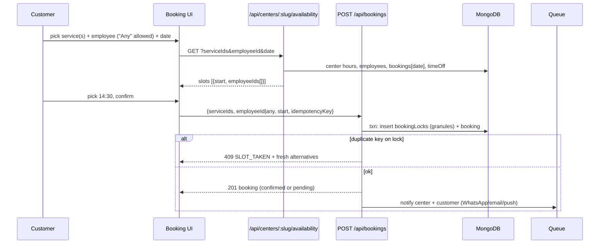
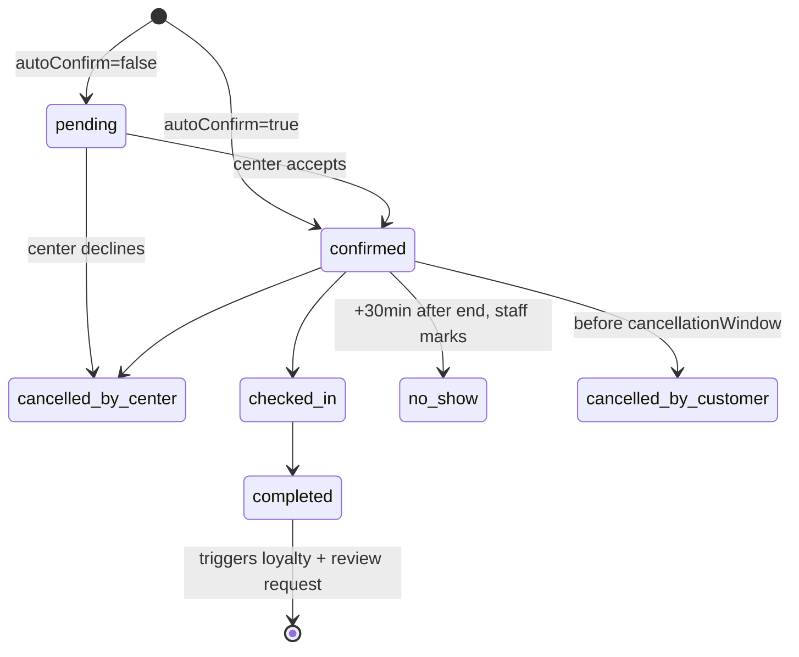

# 5. Booking Engine Design

## 5.1 Flow



## 5.2 Availability algorithm

Implemented as a **pure function** in `src/lib/booking/availability.ts`, which makes it unit-testable and lets it run in an edge or worker context.

Inputs: the center's opening hours and special days, each candidate employee's working hours, time off and existing bookings for the day, the total service duration plus buffer, `slotStepMin`, `minNoticeMin`, and `now`.

```
for each candidate employee E (those who can perform ALL selected services):
  free = intersect(centerHours(day), E.workingHours(day))
  free = subtract(free, E.breaks ∪ E.timeOff ∪ E.bookings(expanded by buffer))
  for t in free stepping by slotStepMin:
     if t + duration ≤ end of its free interval and t ≥ now + minNotice:
        slots[t].add(E)
return slots sorted, each with employeeIds (for "any employee": choose least-loaded at booking time)
```

Complexity is O(E × intervals) per day. It is cheap enough to compute on request. Popular centers get the result cached in Redis for 30s under the key `avail:{center}:{date}:{svcHash}`, invalidated on any booking write for that center and date.

## 5.3 Double-booking prevention: granule locks

Variable-length bookings make a plain unique index on `start` useless. Instead, a booking of `[start, end)` for employee E inserts one `bookingLocks` document per 5-minute granule:

```
_id = "65f...e1:2026-11-20T13:30Z", "65f...e1:2026-11-20T13:35Z", ...
```

All lock inserts and the booking insert run in **one multi-document transaction**. If any `_id` already exists, MongoDB throws `E11000`, the transaction aborts, and the API returns `409 SLOT_TAKEN` with recomputed alternatives. The guarantee comes from the database rather than from application timing, so it holds across any number of app instances.

- **Holds**: during a paid-deposit checkout, locks are inserted with `expiresAt = now + 10 min` (TTL index), so abandoned checkouts free themselves.
- **Cancellation / reschedule** deletes or moves the locks in the same transaction as the status change.
- **Idempotency**: the client sends `Idempotency-Key`, stored in Redis for 24h. A retried request returns the original booking.

## 5.4 State machine



Each transition is a function `transition(booking, to, actor)` that validates the edge and permissions, appends to `history`, and emits a domain event.

## 5.5 Rescheduling, cancellation, wait list

- **Reschedule** is a single transaction: insert the new locks, delete the old locks, update the booking. If the new slot fails, the old one stays intact.
- **Cancellation policy**: free until `cancellationWindowMin` before the start. Later than that, it is flagged as a late cancel, which affects the customer's reliability score (used for future deposit requirements, not shown publicly).
- **Wait list**: when a slot frees up (cancel event), the `waitlist.match` job finds entries whose `[windowStart, windowEnd]` covers it and notifies them in FIFO order over WhatsApp, each with a 15-minute claim link that holds the slot via a TTL lock.

## 5.6 Notifications timeline

| When | Channel | Content |
|------|---------|---------|
| Booking created | WhatsApp + email to customer; push + WhatsApp to center | Ref, date, address and Maps link, cancel link |
| −24h | WhatsApp template `booking_reminder` | One-tap confirm or cancel buttons |
| −2h | Push | "On your way?" with directions |
| +2h after completed | WhatsApp/email | Review request with a deep link (verified review) |
| Freed slot | WhatsApp | Wait list offer |

## 5.7 Owner calendar

- Day, week and resource views (columns = employees). Drag-and-drop to reschedule runs the same transaction path.
- Walk-ins and phone bookings are created from the dashboard with `source: owner_dashboard` and `customerSnapshot`.
- A calendar query uses `{centerId, start: {$gte, $lt}}` on index `{centerId:1, start:1}`. Live updates are pushed via the realtime gateway channel `center:{id}:calendar`.
