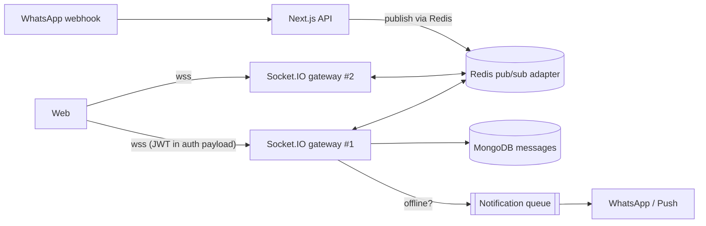

# 6. Chat System Architecture

## 6.1 Topology

- The **gateway** is a small Node service (`apps/realtime` later) on Fly.io in the Paris region, 2+ machines behind its anycast LB, and horizontally scaled through the Redis adapter.
- Vercel functions never hold sockets. They publish events (booking updated, new review) to Redis, and the gateway fans them out.
- **Managed fallback**: if ops capacity is short, swap the gateway for Ably or Pusher behind the same `RealtimePublisher` interface.

## 6.2 Rooms

| Room | Members | Events |
|------|---------|--------|
| `conv:{id}` | customer + center staff with `chat.center` | `message:new`, `message:read`, `typing` |
| `user:{id}` | the user's devices | `notification`, `conversation:updated` |
| `center:{id}:inbox` | center staff | `conversation:updated` |
| `center:{id}:calendar` | center staff | `booking:*` |

The JWT is verified on connect. Joining a room calls the same RBAC `authorize()` the API uses.

## 6.3 Message pipeline

1. The client emits `message:send {conversationId, clientId, type, body | media}`.
2. The gateway validates it with zod, rate-limits it (60/min per user), and persists it with `insertOne`. `clientId` has a unique index, so a retried send is a no-op.
3. It updates `conversations.lastMessage` and increments `unread.{otherSide}` atomically.
4. It broadcasts to `conv:{id}`. If the recipient has no live socket for 30s, it enqueues a push or WhatsApp notification, debounced to one per conversation every 5 minutes.

## 6.4 Media: images, voice notes, files

- The client requests a **signed Cloudinary upload** (`/api/uploads/sign?purpose=chat`) into the folder `chat/{conversationId}`, uploads directly, and sends the `publicId` in the message.
- **Voice notes** are recorded in the browser with `MediaRecorder` (opus/webm), up to 2 minutes, and delivered through Cloudinary as `f_mp3` for iOS Safari.
- Files are limited to pdf, jpg, png and heic, 10MB maximum. Chat media is stored with `type: authenticated`, and delivery uses signed URLs that expire after 1h.

## 6.5 Booking reference & WhatsApp bridge

- A `booking_ref` message type renders as a rich card (service, date, status, actions).
- **WhatsApp integration**:
  - *Outbound:* centers on PRO and above can reply from the Hajemti inbox, and the message is delivered over WhatsApp Business Cloud API through a shared number with a center-tagged template, or through the center's own WABA on Premium.
  - *Inbound:* the webhook `/api/webhooks/whatsapp` maps the phone number to a conversation and inserts the message as `source: whatsapp`.
  - Every center page also has a plain `wa.me/216XXXXXXXX?text=` deep link (free on all plans).

## 6.6 Scale math

At 100k MAU with 5% concurrent online, that is about 5k sockets. One Fly machine handles more than 10k sockets, so 2 machines are enough for HA. Messages are written at roughly 50/s at peak, which an M30 handles trivially. Messages are indexed `{conversationId:1, _id:-1}` with cursor pagination (`_id < lastSeen`, 30 per page).
