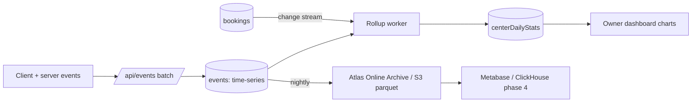

# 7. Analytics Architecture

## 7.1 Two kinds of analytics

| Kind | Audience | Source | Freshness |
|------|----------|--------|-----------|
| **Business analytics** (revenue, bookings, top services) | Center owners/managers | `bookings` (source of truth) → `centerDailyStats` rollups | ~5 minutes |
| **Product analytics** (funnels, conversion, retention) | Hajemti team, plus owners on PREMIUM | `events` time-series | ~1 minute |

## 7.2 Pipeline



### centerDailyStats document
```json
{
  "_id": "65f..:2026-11-19",
  "centerId": "65f..", "date": "2026-11-19",
  "bookings": { "created": 23, "completed": 19, "cancelled": 2, "noShow": 1 },
  "revenueMillimes": 1840000,
  "newCustomers": 6, "returningCustomers": 13,
  "byService": { "65a..": { "count": 7, "revenueMillimes": 630000 } },
  "byEmployee": { "65e..": { "count": 9, "revenueMillimes": 720000 } },
  "funnel": { "profileViews": 412, "bookingStarted": 61, "bookingConfirmed": 23 },
  "bySource": { "web": 14, "whatsapp": 5, "walk_in": 4 }
}
```

Weekly, monthly and yearly charts are `$group` aggregations over at most 366 docs per center, which is always under 50ms. No pre-aggregation beyond daily is needed.

## 7.3 Metrics definitions

| Metric | Definition |
|--------|------------|
| Revenue | Σ `totalMillimes` of `completed` bookings (completion date, Africa/Tunis) |
| Conversion rate | `bookingConfirmed / profileViews` |
| Customer growth | Count of first-ever completed bookings per period |
| Top services | Rank by count |
| Most profitable | Rank by revenue per minute of employee time (`revenue / Σ duration`), which is the metric that actually matters to a salon |
| Retention | Share of customers with ≥2 bookings within 90 days |
| No-show rate | `noShow / (completed + noShow)` |

## 7.4 Business score (public ranking)

Recomputed nightly and on review:

```
score = 0.40 * bayesianRating        // (C*m + Σratings) / (C + n), m = 4.2, C = 10
      + 0.15 * responseRate          // chat replies < 2h
      + 0.15 * completionRate        // completed / (completed + cancelled_by_center + no_show caused by center)
      + 0.10 * activity              // posts, updated availability, last 30 days (normalized)
      + 0.10 * log10(1 + bookings90d) / 3
      + 0.10 * profileCompleteness
```

The Bayesian prior stops a brand-new salon with a single 5★ review from outranking an established one with 400 reviews at 4.8★. Paid plans **never** affect the score; they only buy clearly labeled "Sponsored" or "Featured" placements.

## 7.5 Event taxonomy (excerpt)

`page_view`, `search` (query, governorate, category, results), `center_view`, `service_select`, `slot_view`, `booking_start`, `booking_confirm`, `booking_cancel`, `follow`, `share`, `chat_start`, `promo_click`, `ad_impression`, `ad_click`. Events are batched client-side (max 20 or 10s) with `navigator.sendBeacon`.
